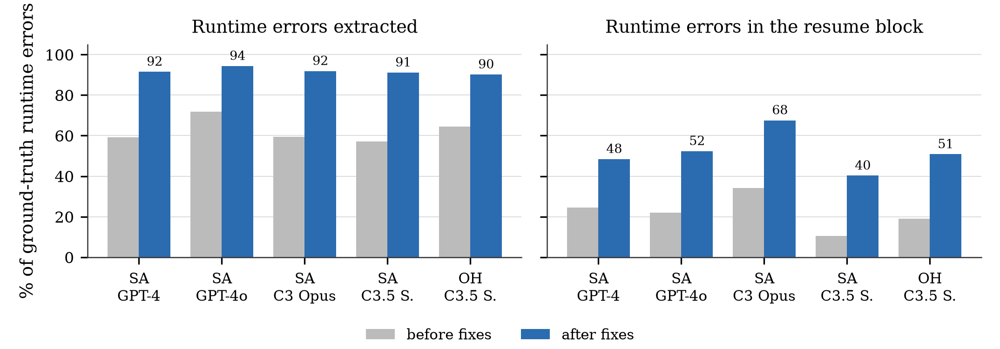
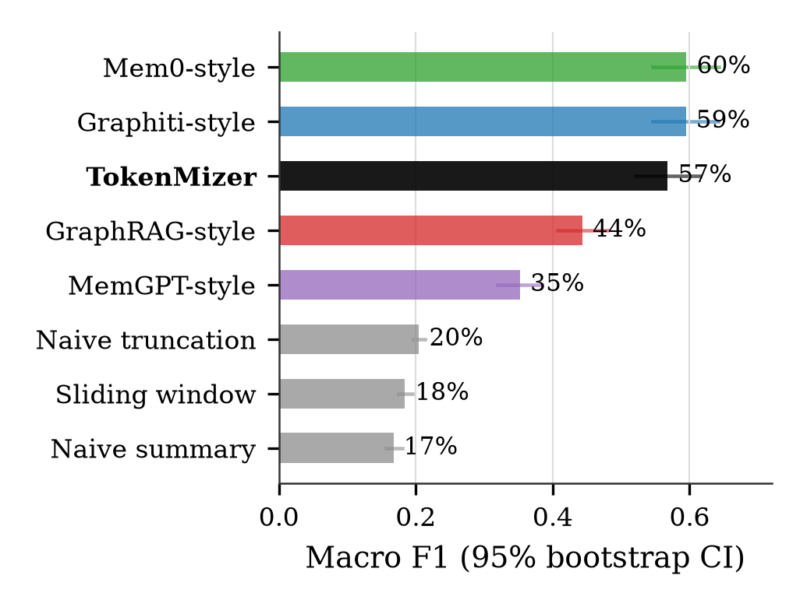

# TokenMizer Research

Research repository for **TokenMizer**, a graph-structured session-memory
system for long-horizon LLM context management. This repository contains
the benchmark suite, the labelled evaluation corpus, all raw results, and
the manuscript for the associated paper. The product itself is maintained
separately at
[`Shweta-Mishra-ai/tokenmizer`](https://github.com/Shweta-Mishra-ai/tokenmizer).

## Paper

**TokenMizer: Graph-Structured Session Memory for Long-Horizon LLM Context
Management** (IEEE Transactions format, journal manuscript)
Shweta Mishra, 2026.

[`paper/tokenmizer_ieee.pdf`](paper/tokenmizer_ieee.pdf) ·
[LaTeX source](paper/tokenmizer_ieee.tex)

The manuscript reports two evaluations:
- a controlled 100-session, 8-method comparison of the released
  TokenMizer 0.5.4 against deterministic reimplementations of MemGPT,
  Mem0, Graphiti/Zep and GraphRAG plus three naive baselines;
- a pre-registered evaluation on **1,467 real agent sessions** from public
  SWE-bench trajectories, with automatic ground truth and a held-out
  split by issue (Section "Evaluation on Real Agent Sessions").

Every comparison carries a bootstrap confidence interval.

### Real agent sessions (n = 1,467; 716 held out)

The data is five public SWE-bench Lite submissions: SWE-agent with GPT-4,
GPT-4o, Claude 3 Opus and Claude 3.5 Sonnet, and OpenHands with function
calling. That is about 31 M tokens of real agent traffic. Ground truth is
automatic:
- the files are the ones the submitted patch changed;
- the errors are the tracebacks and linter errors in tool output.

Defects were located on the dev half only. The test half was scored once
before and once after they were fixed.



| Test split, 716 sessions | Before | After | Paired Δ [95% CI] |
|---|---:|---:|---|
| Runtime-error recall | 63.1% | **91.9%** | +28.8 [+25.3, +32.6] |
| Runtime-error recall, production (one message per call) | 72.4% | **95.7%** | +23.3 [+20.1, +26.9] |
| Error precision vs automatic labels (lower bound) | 16.2% | **30.9%** | +14.7 [+13.3, +16.0] |
| Runtime errors present in the 400-token resume | 20.4% | **50.3%** | +29.9 [+24.4, +35.3] |
| Edited files present in the resume | 51.3% | **67.4%** | +16.1 [+12.1, +20.2] |
| Edited-file recall | 75.3% | 77.5% | +2.2 [−0.6, +4.6] |

The comparison methods recall 5–12% of runtime errors. After the fixes,
TokenMizer's 222-token resume carries more errors and edited files than a
ten-message sliding window of 5,910 tokens. The full tables, the defects
found, and the threats to validity are in
[`benchmarks/results/REPORT_real_agents.md`](benchmarks/results/REPORT_real_agents.md).

### Headline results (n = 100, TokenMizer 0.5.4)



| Method | Macro F1 | 95% CI |
|---|---:|---:|
| **TokenMizer 0.5.4** | **60%** | [55%, 65%] |
| Mem0-style | 60% | [55%, 64%] |
| Graphiti-style | 59% | [55%, 64%] |
| GraphRAG-style | 44% | [41%, 48%] |
| MemGPT-style | 35% | [32%, 38%] |
| Naive truncation | 20% | [20%, 21%] |
| Sliding window (10) | 18% | [18%, 19%] |
| Naive summary | 17% | [16%, 18%] |

TokenMizer significantly outperforms GraphRAG-style, MemGPT-style, and
every naive baseline. Against Graphiti-style and Mem0-style, the
paired-difference confidence interval crosses zero: a statistical tie,
not a loss and not a win, though TokenMizer's point estimate now matches
Mem0-style exactly. TokenMizer's resume block (100 tokens) is smaller
than Graphiti-style's and Mem0-style's (118–120) but larger than
MemGPT-style's (60), which reaches that size by seeing under half the
conversation rather than by encoding it more efficiently. Its two
weakest categories, both in absolute terms and relative to the two
methods it otherwise ties, are decision extraction (59% F1, against 65%
for Graphiti/Mem0-style) and error extraction (44% F1, against 66%).
An earlier version of this evaluation (TokenMizer 0.5.3, superseded)
found these same two categories further behind (50% and 36% F1); the
gaps identified there were closed to the extent a targeted vocabulary
and pattern fix could close them — see the product repository's 0.5.4
CHANGELOG. Every pattern-matching method tested — TokenMizer included —
still degrades to 19–27% macro F1 on sessions that state facts
indirectly rather than with explicit lexical markers, a shared
limitation of regex-based extraction quantified here across four
independently implemented strategies on one corpus, and unmoved by this
fix since it targets vocabulary coverage, not the underlying
architecture.

### Since 0.5.4 (unreleased product `main`, re-measured 2026-09-24)

Same benchmark, product `main` at `a184cf1`: macro F1 **60.0% → 61.3%**,
a paired gain of **+1.25 points, 95% CI [+0.46, +2.12]**. The gain is
real but small. Nearly all of it is in decisions (59% → 64% F1, now level
with Graphiti/Mem0-style). Errors barely moved (44% → 46%, still 20 points
behind), and implicit-register sessions are unchanged (27% → 29%). The
tie with Graphiti/Mem0-style still holds. Two sessions regressed because
of a new product error pattern that reads "failed" used as an adjective
("retry for failed deliveries") as an error. Extraction is also ~50%
slower. Full before/after analysis, including the root cause:
[`benchmarks/results/REPORT_post_0.5.4.md`](benchmarks/results/REPORT_post_0.5.4.md).
The paper still reports the released 0.5.4.

### Extraction rounds on unreleased `main` (2026-09-25)

Two rounds of extraction work on the product branch, measured on three
corpora. Of these, **only held-out v2 was never tuned against**:

| Corpus | Before (`a184cf1`) | After (`b6a5422`) |
|---|---:|---:|
| Main corpus (n=100). Tuned against it. | 61% | 92% |
| Held-out v1 (n=80). Contaminated by round 3. | 40% | 79% |
| **Held-out v2 (n=80). Never tuned against.** | **33%** | **51%** |

The honest gain is **+17.4 points [+14.6, +20.4]** on phrasing the fixes
never saw. It came with precision up in every category, extraction about 22%
slower (15 → 19 ms median per session), and resume blocks about 47% larger.
Pending-task recall (19%) and errors (45% F1) on held-out v2 remain weak,
and pattern matching has a ceiling on implicit phrasing. The comparison
methods are regex reimplementations, not the vendor products, so none of
this is a claim against Mem0 or Zep. Full protocol and numbers:
[`benchmarks/results/REPORT_extraction_rounds.md`](benchmarks/results/REPORT_extraction_rounds.md).

A follow-up round tested the product on what the corpora cannot contain: a
real 914-message agent session, a fuzzer, a scan of all 134 regexes, and a
concurrent load test of the HTTP endpoint. It found and fixed several
problems:
- Agent tool calls were never read.
- Tool-only turns were silently skipped as duplicates.
- One message of padded whitespace took 10 seconds (a proxy DoS).
- One legal JSON character crashed extraction.

On that real session, about 87% of stored facts are genuine, against about
45% before (judged by hand). The labelled-corpus scores are unchanged. See
[`benchmarks/results/REPORT_real_sessions_and_robustness.md`](benchmarks/results/REPORT_real_sessions_and_robustness.md).

Rounds 5 and 6 (same report):
- A fourth corpus, **held-out v3**, was frozen before round 5. On it, the
  whole branch scores **35% → 64%** macro F1 (+29.6 points [+26.2, +32.8]).
- The resume block is now packed item by item. At a 150-token budget it
  keeps 73.5% of labelled facts, against 66.8% before, and open errors go
  from 40% to 73%. Completed tasks lose 8 points at that budget, by
  design.
- Incremental extraction, the way the proxy runs it, now builds 675 of the
  676 graph edges that whole-session extraction does, against 177 of 707
  before. Files are now matched at word starts, which removed 31 links,
  nearly all of them false.
- A pre-existing cap on remembered messages made every request past
  message 500 re-extract the old history. On a real agent session the
  late-session median fell from 115 ms to 21 ms.

Round 8 (same report) is a negative result for pattern matching:
- New constructions for marker-free phrasing lifted the development sets
  (v1 80% → 92%) and left both untouched sets **exactly unchanged**
  (v3 64%; v4 58%, frozen before the round). Pattern matching has reached
  its limit there; the route is the LLM extraction path, which needs an
  API key.
- Per-request cost late in a real agent session fell from 21 ms to 7.3 ms.
- Fixed bugs listed under a "fixed" heading are now stored as resolved,
  not open.

### Long sessions, and a re-measurement of `main` (2026-11-12)

Product `main` (`6b26679`) against the audit branch's final commit
(`943b7cd`). Full protocol and numbers:
[`benchmarks/results/REPORT_long_sessions.md`](benchmarks/results/REPORT_long_sessions.md).

**Labelled corpora are flat.**
- n=100: 92.4%.
- Held-out v1 and v2: 92.3% and 93.0%.
- Held-out v3: 64.3% → 64.2%. One session changed, explained in the report.
- Held-out v4: 58.3% → 58.5%.

On v3 and v4 the best comparison method reaches 35% and 25%.

**On the 716 real agent sessions**, in production mode (one message per call):
- error precision: +1.8 points [+1.0, +2.6];
- runtime errors in the resume: +2.8 [+1.4, +4.3];
- recall: unchanged.

**A long-session soak (new, in the product repository) found six defects
that no corpus could contain.**
- At 120 turns the graph kept 23 of 50 planted facts.
- At 1,000 turns, with 19.7 MB of history and a 4 MB tool output, it now keeps all 50. It recalls all 50 into the request that asks, keeps all 50 across a restart, and leaks 0 of 80 facts across 8 concurrent sessions.
- The round-6 fix for re-extracting old history past message 500 still failed whenever an old message repeated a recent one: a repeated "ok", or the same tool output. One request at 300 turns took 12.2 s and now takes 0.25 s.
- A cold start on a real 6.5 MB agent session took 57 s on `main` and now takes 1.5 s.

**Found and not fixed:**
- A decision's scope is not part of its identity. The billing service's choice is "superseded" by the ledger service's.
- A change of mind ("switch to X instead") is often not extracted.

The S3 bucket of the real-agent study now refuses listing, so
`fetch.py --sessions-from` downloads the sessions by key.

Four of the seven comparison methods reproduce one structural property
of a published system, deterministically and with no language-model
call — they are not the vendor products. See
`benchmarks/memorybench/methods/` and the paper's Threats to Validity
section before quoting any of these four under the named system's
identity.

## Repository layout

```
paper/                    Manuscript source, figures, and compiled PDF
  tokenmizer_ieee.tex        IEEE-format manuscript (this repo's primary output)
  figures/                   Publication figures + generator script
  fig1_architecture.png,     Architecture figures referenced by the manuscript
  fig2_graph.png

benchmarks/
  memorybench/               n=100 multi-method benchmark: corpus loader,
                              scorer, synthetic-session generator, and all
                              eight method implementations
  corpus/                    100 labelled sessions (94 generated, 6 real)
  corpus_heldout/            80 held-out sessions, disjoint templates (v1)
  corpus_heldout2/           80 held-out sessions, a third template set (v2)
  corpus_heldout3/           80 held-out sessions, a fourth template set (v3)
  corpus_heldout4/           80 held-out sessions, a fifth template set (v4)
  realworld/                 Real-agent benchmark: fetch script, converters
                              for SWE-agent and OpenHands trajectories, the
                              frozen protocol (README.md), runner, tables
  results/                   Raw results (JSON/CSV), REPORT_n100.md,
                              interactive dashboard.html
  results/realworld/         Per-session results of the real-agent test
                              split, both product commits, both conditions
  checkpoint_accuracy/       Earlier 21-session benchmark, kept for history;
                              not covered by the current manuscript
```

## Reproducing the results

No installation is required; the benchmark suite is pure standard-library
Python.

```bash
git clone https://github.com/Shweta-Mishra-ai/tokenmizer-research
cd tokenmizer-research

# Run the n=100 multi-method benchmark
python -m benchmarks.memorybench.run --json out.json --csv out.csv

# Regenerate the 94-session synthetic corpus (seeded, deterministic)
python -m benchmarks.memorybench.generate -n 86

# Real-agent benchmark: fetch public trajectories (~280 MB, not committed),
# convert, score the held-out split, and print the report's tables.
# The bucket refuses listing since 2026-11; fetch the test split by key:
python -m benchmarks.realworld.fetch --out DIR --sessions-from benchmarks/results/realworld/test_fix.json
python -m benchmarks.realworld.run_real --data DIR --split test --json out.json
python -m benchmarks.realworld.tables --base BASE.json --fix FIX.json

# Run the earlier 21-session benchmark (kept for history, not covered by the paper)
python3 benchmarks/checkpoint_accuracy/runner_v2.py
```

Reproducing TokenMizer's own results additionally requires a checkout of
the product repository (path configurable via `TOKENMIZER_PRODUCT_REPO`,
default `/home/user/tokenmizer`); the other seven methods have no external
dependency.

Regenerating the manuscript's figures requires `matplotlib` and `numpy`;
recompiling the PDF requires a LaTeX distribution with the `IEEEtran`
class (`texlive-publishers` on Debian/Ubuntu):

```bash
pip install matplotlib numpy
python3 paper/figures/generate_figures.py
python3 paper/figures/generate_real_figures.py
cd paper && pdflatex tokenmizer_ieee.tex && pdflatex tokenmizer_ieee.tex
```

Full methodology, per-category and per-register breakdowns, and stated
limitations: [`benchmarks/results/REPORT_n100.md`](benchmarks/results/REPORT_n100.md).
Interactive results dashboard: [`benchmarks/results/dashboard.html`](benchmarks/results/dashboard.html).

## Citation

```bibtex
@article{mishra2026tokenmizer,
  author  = {Mishra, Shweta},
  title   = {TokenMizer: Graph-Structured Session Memory for
             Long-Horizon LLM Context Management},
  year    = {2026},
  note    = {Manuscript and reproduction code available at
             \url{https://github.com/Shweta-Mishra-ai/tokenmizer-research}}
}
```

## Contributing

See [`CONTRIBUTING.md`](CONTRIBUTING.md). Priority areas: real labelled
transcripts, LLM-backed variants of the comparison methods, additional
domains and threshold-sensitivity analysis.

## License

MIT License © Shweta Mishra 2026. See [`LICENSE`](LICENSE).
